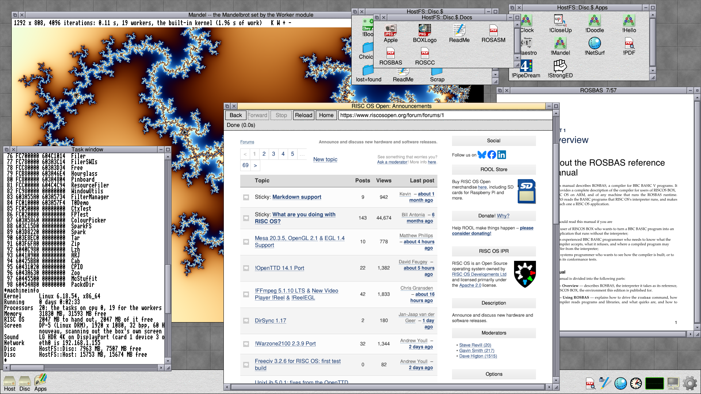

# BOX

A RISC OS environment for generic devices.

*RISC OS's components translated to C, running on a Linux kernel, on a 64-bit PC or a Mac.*

**This is not RISC OS.** BOX is a RISC OS window manager and application
environment running on a Linux kernel. It is not RISC OS, it is not a port
of RISC OS, and it does not claim to be either. It aims to be reasonably
compatible: it runs translated applications, and some emulated ones.

## Work in progress, Sunday 18th October 2026

Not released yet. What has been going on since the 11th:

- **Compositing.** On the PC builds every window now has a picture of its own, and a separate program puts the desktop together on the graphics card, with shadows and rounded corners over a backdrop the card draws itself. See [The Compositing Wimp](articles/8-Compositing.md).
- **Four PCs tested.** The same build has been run on an i7-12700 with an NVIDIA T1000, an Alder Lake-N mini PC, a Dell Latitude laptop, and a PC booted from a USB stick. See [BOX on a Low-Cost Mini PC](articles/9-MiniPC.md).
- **New BOX RISC OS apps.** A word processor, a drawing program, a paint program, a spreadsheet and a PDF editor, written for BOX, which open the document formats the rest of the world uses. See [Apps for BOX](articles/10-Apps.md).

## Sunday 11th October release

The same release for all three kinds of machine, built from one source.

### Release notes

New features:

- **Lua.** LuaJIT, with `*LuaJIT` to run Lua scripts and a `riscos` library for RISC OS calls.
- **Painted desktop themes.** The desktop can be drawn in themes, from painted sprites.
- **The Appearance application,** to choose the theme and the desktop's look.
- **Metal acceleration on the Mac.** The Mac releases draw the screen through Metal.
- **New metrics views** from the monitor (DeskMeter): a Linux window showing each processor, memory, paging, system calls, SWIs, disc and network a second, and the `*LinuxStats` command.

Also:

- Reading the clock no longer costs a system call on Apple silicon, so SWIs run about three times faster. Intel Macs and PCs always read it this way, so this brings Apple silicon up to the same speed rather than making it quicker than Intel.
- Miscellaneous bug fixes and quality improvements.

Fixes (2026.10.11.3):

- The mouse pointer no longer disappears after the desktop theme is changed.
- Sound from several programs now plays together, and SharedSound's handlers run safely.

### Downloads

| Machine | Download | Needs |
| --- | --- | --- |
| Apple silicon Mac | [BOX-arm64-mac-2026.10.11](https://github.com/albanread/Aldershot/releases/tag/BOX-arm64-mac-2026.10.11) | macOS 14 or later; M1 or later |
| Intel Mac | [BOX-x64-mac-2026.10.11](https://github.com/albanread/Aldershot/releases/tag/BOX-x64-mac-2026.10.11) | macOS 14 or later |
| Intel PC, UEFI boot | [BOX-x64-pc-2026.10.11](https://github.com/albanread/Aldershot/releases/tag/BOX-x64-pc-2026.10.11) | a 64-bit PC that boots by UEFI with Secure Boot off; a USB stick of 16 GB or more |

## Other downloads

BBC BASIC on its own, and every earlier preview, are on the
[Releases page](https://github.com/albanread/Aldershot/releases):

- [Just BBC BASIC translated](https://github.com/albanread/Aldershot/releases/tag/BBCBASICVA64-1.2) (BBCBASICVA64, Apple silicon Macs, macOS 14 or later)
- [Just BBC BASIC translated, for Intel Macs](https://github.com/albanread/Aldershot/releases/tag/BBCBASICVX64-1.2) (BBCBASICVX64, macOS 14 or later)

## Apps

Apps for RISC OS BOX, written in easy to understand Mojo, backed by Rust library code.

A RISC OS desktop should be able to open the files everyone else sends: a `.docx`, an SVG, a PDF, an `.xlsx`. So BOX has applications of its own, split in two. The part the person uses is an ordinary Wimp task, written in Mojo, which behaves as a RISC OS application should. The part that understands the document is existing Rust code, large and complicated and maintained in the open by people who care about those formats.

| Application | What it is | Opens and saves |
| --- | --- | --- |
| !Scribe | a word processor | `.docx` |
| !Trace | a drawing program | SVG, PostScript and EPS, Draw files |
| !Palette | a paint program | PNG, JPEG |
| !Ledger | a spreadsheet | `.xlsx`, CSV |
| !Folio | a PDF reader and editor | PDF |

[Apps for BOX](articles/10-Apps.md) describes how they are put together, why Mojo for the user interface and Rust underneath it, and how the two halves talk.

## Ports

The modules and applications in BOX are ported. Some need only small changes. Others are rewritten completely in C. The work is done a step at a time, and a port may bring in bugs that the original does not have.

Please do not report missing features or faults in BOX's software to the original authors. Their ARM code very likely works perfectly on a Raspberry Pi 4; the fault is in the port, not in their work.

There is no need to report them here either. The project finds faults itself, by testing BOX against RISC OS 5.30.

## Performance

RISC OS's own ARM code is extremely efficient on an ARM processor such as the Raspberry Pi 4's Cortex-A72. Porting that code to C costs a good deal of speed, and needs more memory. Translated C is also 1.5 to 3 times slower than C written by hand.

So BOX is not suited to Raspberry Pi class machines. It performs well on computers such as Apple silicon Macs, or PCs with an Intel Core i7-12700, or even a low cost mini PC: see [BOX on a Low-Cost Mini PC](articles/9-MiniPC.md).

BBC BASIC suffers from the translation too, and does not run as much faster as the difference in processor power might suggest. To make up for this, BOX includes a translator from BBC BASIC to C, `*RosBas`.

## Documents

- [articles](articles/README.md): technical articles about BOX, in the style of the
  RISC OS Programmer's Reference Manuals. Start with [BOX Design](articles/0-Design.md).
- [docs](docs/README.md): documents about BOX. [Bugs and quirks](docs/bugs-and-quirks.md) lists the bugs, quirks and documentation errors noticed in RISC OS 5.30 and its applications while porting them.

## Licences

Important licence update information has been added to the repository: see [LICENSES](LICENSES/README.md).

*Anyone with genuine concerns about software licences should raise an issue.*

*BOX does not claim ownership of any code that the project did not originally write. The project is publishing translated source code: the C in [src/box](src/box/README.md) is translated from other people's code, and keeps their licence. The project actually builds most modules from the original assembler code, which is typically more readable, and which is available from its own repository ([RISC OS Open's](https://gitlab.riscosopen.org/RiscOS/Sources)).*

- [LICENSES](LICENSES/README.md): the licence of every component. BOX's own code is under the MIT licence. RISC OS is RISC OS Open Ltd's, under the Apache License 2.0.
- [gpl](gpl/README.md): the source of the components under the GNU GPL, GNU LGPL, MPL 2.0 and CDDL.

Code that BOX has translated to C stays under the licence of the code it was translated from: RISC OS translated to C is still under the Apache License 2.0. BOX claims no ownership of translated code.

## Source code

The project is publishing translated source code: the C in [src/box](src/box/README.md) is translated from other people's code, and keeps their licence. The project actually builds most modules from the original assembler code, which is typically more readable, and which is available from its own repository ([RISC OS Open's](https://gitlab.riscosopen.org/RiscOS/Sources)).

The source of every component whose licence asks for it is in [gpl](gpl/README.md).

Published so far, in [src](src):

- [BOX](src/box/README.md), the source of `/init`: the runtime, the platform layer, the boot code and the modules written for BOX;
- [ROSASM](src/ROSASM/README.md), the ObjAsm-compatible assembler;
- [ROSBAS](src/ROSBAS/README.md), the BBC BASIC V compiler (the compiler only; its runtime library will follow).
- [BBC BASIC V, translated to C](src/translated/bbcbasic/README.md): RISC OS's BBC BASIC interpreter, translated by hand from ARM assembler; under ROOL's Apache License 2.0.
- [The Compositing Wimp](src/compositing-wimp/README.md): the Window Manager as the PC builds run it, where every window has a picture of its own, with the presenter that composites the desktop and the block format they share; under ROOL's Apache License 2.0, with the BOX project's compositing work.
