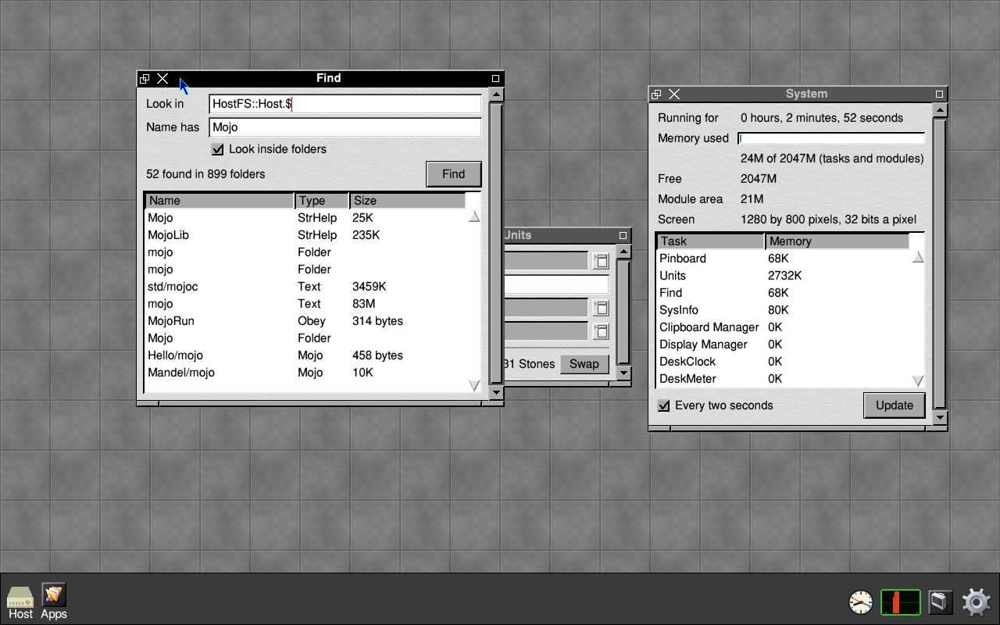
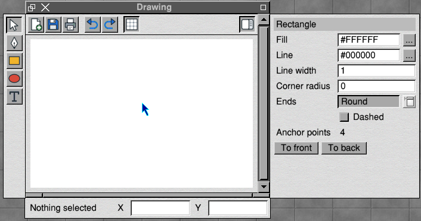

# Declaritive

*30 October 2026*

**Note — this is not RISC OS.** BOX is a RISC OS window manager and application
environment running on a Linux kernel. It is not RISC OS, it is not a port
of RISC OS, and it does not claim to be either. It aims to be reasonably
compatible: it runs translated applications, and some emulated ones.

## Introduction

Declaritive is a relocatable module that makes Wimp windows from a
description of them. A program says what a window holds: a heading, three
fields, a list and two buttons, say. Declaritive works out where each of
them goes, makes the icons, keeps them in place when the window is resized,
and tells the program by name when something is clicked or changed.

It is in BOX's ROM, and any language that can call a SWI can use it. We
have used it from BBC BASIC, C, Lua, Mojo, Tcl and Lisp.

This article covers:

- what Declaritive is, in plain terms;
- how it works, from the program's side;
- four small programs, in BBC BASIC, C, Lua and Lisp;
- the architecture of the module;
- the design decisions behind it;
- what it gives a programmer, and what it does not.

The full list of window parts and their properties is in the module's own
`docs/SPEC.md`; this article does not repeat it.

---

## 1 What Declaritive is

A RISC OS window is normally made of icons placed at fixed coordinates.
The coordinates come from a template file drawn in a template editor, or
from a Toolbox resource, or from numbers typed into the program. Either
way, someone decides that the Name field starts 196 OS units from the left
and 104 down, and that decision is fixed. A longer label, a translated
message or a wider window means placing the icons again. Nothing grows
when the window is made bigger, and nothing lines up unless the author
lined it up by hand.

Declaritive takes the other approach. The program does not place
anything. It describes the window as a tree:

- containers, which arrange what is inside them: a *stack* puts things one
  under another, a *row* side by side, a *form* puts labels in one column
  and fields in the next so that the fields line up, a *grid* in columns,
  a *card* in a labelled box, *tabs* one page at a time;
- controls, which the person uses: text, buttons, option and radio
  buttons, writable fields, number fields with adjuster arrows, sliders,
  progress bars, pop-up menus, lists, tables, text areas, images, canvases
  and surfaces;
- the window's own parts: its title, its menu, its icon bar icon, and its
  panes, which are a toolbar, side panes and a foot.

The description is written in JSON, a plain text format that every
language can produce. Declaritive reads it, measures every part in the
desktop font, places them to the RISC OS Style Guide's sizes and gaps, and
makes ordinary Wimp icons. When the window is resized it places them again.
When the person clicks a button, chooses from a menu, types in a field and
presses Return, or drops a file on the window, the program is told the name
of the part and what happened.

The idea and the description format come from wingui, a library we wrote
for Windows. A description that uses only the common controls is understood
by both.

---

## 2 How it works

A program that uses Declaritive does four things.

1. It calls `Declaritive_Initialise` instead of `Wimp_Initialise`. This
   starts the Wimp task as usual.
2. It calls `Declaritive_Create` with the description. The window appears.
3. It polls the Wimp as any RISC OS program does, and passes every event
   it receives to `Declaritive_Dispatch`. Declaritive handles what belongs
   to its windows: redraws, resizes, clicks on icons, keys in fields, menu
   choices, messages. When something happens that the program should know
   about, Dispatch returns an *event*: a kind (click, change, submit,
   menu, close, drop and so on), the name of the part, its id, and a value.
4. When the program wants to show something new, it sets a property on a
   part by its id: `Declaritive_Set window, "msg", "text", "Done"`.

The program never sees an icon handle or a coordinate, and it never draws
a window itself unless it wants to (canvases and surfaces are for that).

Declaritive does not call `Wimp_Poll` on the program's behalf. On RISC OS a
module must not poll from inside a SWI, so the program keeps its own poll
loop. The language libraries wrap the two calls in one `poll` or `run`
function, so in practice the program writes handlers and nothing else.

Every window can also be driven from outside the program. Each part has an
id, and `*DeclaritiveSet`, `*DeclaritiveGet` and `*DeclaritivePress` work on
any window in the desktop by its id. `*DeclaritivePress units swap` does
exactly what a click on the Swap button would, and the program cannot tell
the difference. That makes Declaritive programs scriptable from an Obey
file, a TaskWindow or an SSH session, and testable without a mouse.

---

## 3 Examples

Each of these makes the same small window: a line of text and a Greet
button that changes the text when it is pressed.

### 3.1 BBC BASIC

BASIC needs no library. It calls the SWIs directly, and the description is
a string. Single quotes are allowed in Declaritive's JSON so that it can be
written inside a BASIC string.

```basic
   10 REM > Hello -- Declaritive from BBC BASIC: no library, just SYS
   20 DIM blk% 255
   30 spec$="{'type':'window','id':'hello','title':'Hello','body':{'type':'stack','children':["
   40 spec$+="{'type':'text','id':'msg','text':'Press the button'},"
   50 spec$+="{'type':'button','text':'Greet','event':'greet','default':true}]}}"
   60 SYS "Declaritive_Initialise",1,"Hello" TO task%,mask%,pw%
   70 SYS "Declaritive_Create",0,spec$ TO win%
   80 next%=0:count%=0
   90 REPEAT
  100   IF next% THEN SYS "Wimp_PollIdle",mask%,blk%,next%,pw% TO reason% ELSE SYS "Wimp_Poll",mask%,blk%,,pw% TO reason%
  110   SYS "Declaritive_Dispatch",reason%,blk% TO kind%,,name$,,,,,mask%,next%
  120   IF name$="greet" THEN count%+=1:SYS "Declaritive_Set",win%,"msg","text","Hello, pressed "+STR$count%+" times"
  130 UNTIL kind%=7 OR kind%=5
  140 SYS "Declaritive_CloseDown"
  150 END
```

Kind 7 is Quit and kind 5 is the window's close icon. `next%` is the time
of the next timer event, if the window has asked for one.

### 3.2 C

The C library, `declaritive.h`, is a single header. It has the poll loop
and calls a handler by the event's name.

```c
#include "declaritive.h"

static dk_window win;
static int count;

static void greet(dk_event *ev, void *ctx)
{
    dk_setf(win, "msg", "text", "Hello, pressed %d times", ++count);
}

int main(void)
{
    dk_init("Hello");
    win = dk_window_spec(
        "{'type':'window','id':'hello','title':'Hello','body':{'type':'stack','children':["
        "{'type':'text','id':'msg','text':'Press the button'},"
        "{'type':'button','text':'Greet','event':'greet','default':true}]}}");
    dk_on("greet", greet, NULL);
    return dk_run();
}
```

It is built in the box with `*CC c.hello -o Hello`.

### 3.3 Lua

The Lua library builds the description from Lua tables, so the window is
written as Lua rather than as a string.

```lua
package.path = "Declaritive:?;" .. package.path
local ui = require "declaritive"

local app = ui.app("Hello")
local count = 0
local win = app:window{ id = "hello", title = "Hello",
  ui.stack{
    ui.text{ id = "msg", text = "Press the button" },
    ui.button{ text = "Greet", event = "greet", default = true } } }
app:on("greet", function()
  count = count + 1
  win:set("msg", "text", "Hello, pressed " .. count .. " times")
end)
app:run()
```

### 3.4 Lisp

In !Lisp the description is a property list, and the handler is a
function of one event. The Lisp engine runs as a Linux program; the window
is made for it by !Lisp's front end, which is a Wimp task.

```lisp
(require 'declaritive)

(defvar *hello* nil)
(defvar *presses* 0)

(defun run-decl-hello ()
  (setq *hello*
        (decl-window
         '(:type "window" :id "hello" :title "Hello from Lisp"
           :body (:type "stack"
                  :children ((:type "text" :id "msg" :text "Press the button")
                             (:type "button" :id "go" :text "Greet" :default t))))
         (lambda (ev)
           (when (equal (getf ev :id) "go")
             (decl-set *hello* "msg" "text"
                       (format nil "Hello, pressed ~D times" (incf *presses*))))))))
```

Mojo and Tcl have libraries of the same shape. The three utilities on the
disc, !Units in Lua, !Find in C and !SysInfo in Mojo, are longer examples.



---

## 4 Architecture

### 4.1 The parts of the module

Declaritive is ordinary RISC OS C: a cmhg header, `_swix` calls and the C
library. It has four parts.

| Part | File | What it does |
| --- | --- | --- |
| The reader | `json.c`, `spec.c` | reads the JSON into a tree of nodes, checks it, and reports a fault by its place in the tree (`units/body/2`) |
| The layout engine | `layout.c` | measures every node and places it; it knows nothing about the Wimp |
| The Wimp side | `wimp.c` | makes and moves icons, draws what icons cannot show, handles every Wimp event and message for its windows, and turns them into events |
| The module | `module.c` | the SWIs, the `*` commands, the files it puts in ResourceFS, and tidying up when a task ends |

The layout engine does not call the Wimp, so it is built and tested on the
host computer: every description in the test set is laid out with a fixed
text width and compared with a saved result.

### 4.2 The SWIs

The SWI chunk is &C0380.

| SWI | What it does |
| --- | --- |
| `Declaritive_Initialise` | starts a Wimp task; returns the poll mask and a poll word |
| `Declaritive_Create` | makes a window from a description |
| `Declaritive_Dispatch` | handles one Wimp event; returns the program's event, if any |
| `Declaritive_Set`, `_Get` | sets or reads a property of a part by its id |
| `Declaritive_Patch` | sets many properties at once, from JSON |
| `Declaritive_Update` | replaces a window's contents with a new description |
| `Declaritive_Open`, `_Close`, `_Delete` | as their names say |
| `Declaritive_Press` | does what a click or choice on a part would |
| `Declaritive_Find`, `_Enumerate` | finds windows by id, for scripts |
| `Declaritive_Validate` | checks a description without making a window |
| `Declaritive_Handles` | the Wimp handles behind a part, for a program that needs them |
| `Declaritive_CloseDown` | deletes the task's windows and ends the task |

Window handles are Declaritive's own small numbers, not the Wimp's.

### 4.3 Windows, icons and drawing

Each control is one or more ordinary Wimp icons, with their text in
buffers Declaritive owns. The desktop theme therefore draws them, the Wimp
handles the caret and editing in fields, and Tab moves between fields as it
does in any window. A few things cannot be shown by icons: a slider's bar,
a progress bar's fill, a canvas's drawing, a colour swatch. Declaritive
draws those itself in the window's redraw. A window that has none of them
is redrawn by the Wimp alone.

A *surface* is a child window with nothing in it, laid out like any other
part and kept in place as the window moves. A program binds its own
picture to it, or draws in it. !Lisp's editor and the game panes use
surfaces.

### 4.4 Panes

A window may have a toolbar across its top, panes down its left and right
sides, and a foot along its bottom, as BOX's own applications have. Each is
a window of its own:

- the toolbar is nested in the main window, so the Wimp moves and resizes
  it with the window;
- the side panes and the foot sit outside the window's frame and follow
  it. When the window is pushed against the edge of the screen and a pane
  has no room outside, the pane folds in over the window's work area, and
  goes back outside when there is room again.

A toolbar button can show and hide a pane. The properties pane is a list of
rows (a heading, values, fields, choices, colours and buttons) that the
program sets again whenever the selection changes. When the new rows have
the same shape as the old ones, only the values that differ are changed,
so the pane does not flicker and a field being typed in is left alone.



### 4.5 Tasks and scripting

A window belongs to the task that made it. When a task ends without
calling `Declaritive_CloseDown`, Declaritive deletes its windows when the
Wimp tells it the task has gone.

Work asked for by another task, such as `*DeclaritivePress` typed in a
TaskWindow, is not done in that task. It is queued for the window's owner,
and the owner is woken through its poll word. The work is then done inside
the owner's own `Declaritive_Dispatch`, where its Wimp calls are the
owner's.

---

## 5 Design

### 5.1 Layout in two passes

Layout is done in two passes over the tree.

1. **Measure**, from the leaves up: each node's natural size, the smallest
   it can be. A label is as wide as its text in the desktop font; a field
   is its label plus at least 200 OS units; a stack is as wide as its widest
   child and as tall as its children and the gaps between them.
2. **Arrange**, from the root down: each node is given a rectangle at least
   its natural size and places its children in it.

Space left over goes to the children that ask for it with `grow`. Across a
container, a child is stretched to fill unless its `align` says otherwise.
Fields, lists and sliders stretch by default; buttons and labels keep
their natural width. The window cannot be made smaller than its contents.

### 5.2 The Style Guide's sizes

The sizes and icon flags are the RISC OS 3 Style Guide's: an action button
is 52 OS units high and a default button 68, a writable field 52, an option
button 44, gadgets 8 apart and a window's contents 16 from its edge. Save
boxes follow the Style Guide's save protocol, with the file icon dragged to
a directory display. Declaritive makes it easier to produce a window that
looks and behaves like any other RISC OS window than one that does not.

### 5.3 What the program owns

The program owns its data. The description says what is shown, and the
program changes what is shown by setting properties or by giving a new
description. Declaritive keeps no copy of the program's data beyond what
is on the screen, and it never decides anything for the program: it only
reports what the person did.

---

## 6 Benefits

For a programmer:

- **Less code.** A window that would take a template file and a few
  hundred lines of icon handling takes a description and a handler for
  each thing that matters.
- **Windows that resize properly.** Fields widen and lists lengthen when
  the window is made bigger, with no code in the program.
- **Any language.** The same SWIs serve BBC BASIC, C, Lua, Mojo, Tcl and
  Lisp, and a description written for one works for all of them.
- **The Style Guide for free.** Sizes, gaps, default and cancel buttons,
  Return and Escape, Tab between fields, !Help text, drag-and-drop and save
  boxes behave as RISC OS users expect.
- **Scripting and testing.** Every part has an id, so any window can be
  driven by `*` commands; a test can press buttons and read fields with no
  mouse.

For the system:

- **Native windows.** Declaritive makes ordinary Wimp windows and icons, so
  themes, the caret, menus and the rest of the desktop treat them as they
  treat any window.
- **One place for layout.** A fault in layout is fixed once, in the
  module, for every program that uses it.

What it does not do: it is not a drawing library, and a program that wants
to draw its own content still draws it, in a canvas or a surface. Nor is
it a replacement for the Toolbox in programs that already use the Toolbox;
it is for new programs, and for programs written in languages that the
Toolbox does not serve well.
