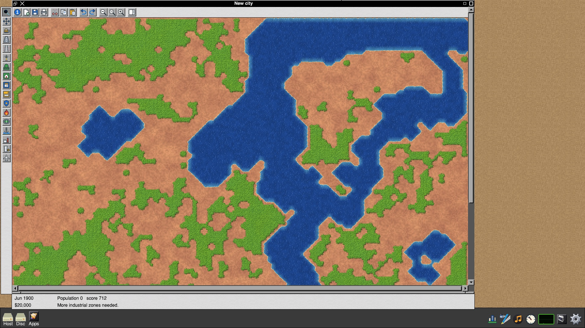

# BOX on the 2018 Mac mini

*30 October 2026*

**Note: this is work in progress.** We have one of these machines, and
this article describes that one. It works well and is in daily use, but
we cannot promise that yours will behave the same, particularly if it is
built differently from ours (section 1 says how). Installing BOX erases
the Mac. [BOX on Second-Hand Intel Macs](12-Macs.md) covers preparing the machine and
getting macOS back.

## Introduction

The 2018 Mac mini was the last Intel Mac mini. It is a small aluminium
box, silent at the desktop, with a six-core processor in its better
versions and room for up to 64 GB of memory. On eBay in October 2026 one
costs between 160 and 370 pounds depending on its specification.

Ours has run BOX from its own SSD since 24 October 2026, with macOS
erased. This article covers:

- the machine we have, and how others differ;
- which parts of the hardware BOX uses so far;
- what software we have run on it;
- what is not done yet.

---

## 1 The machine

| | |
| --- | --- |
| Model | Macmini8,1, late 2018 |
| Processor | Intel Core i7-8700B, 6 cores, 12 threads, 3.2 GHz (4.6 GHz turbo) |
| Memory | 16 GB |
| Graphics | Intel UHD Graphics 630, built into the processor |
| Display | an LG 4K monitor on HDMI, 3840 x 2160 at 60 Hz |
| SSD | Apple 256 GB, behind the T2 chip |
| Network | 10 Gb Ethernet (Aquantia AQC107), Wi-Fi and Bluetooth (Broadcom BCM4364) |
| Last macOS | macOS 15 Sequoia |

The mini was sold with a quad-core i3, a six-core i5 or a six-core i7,
and the graphics are the same in all three. The i3 and i5 machines should
behave as ours does, a little slower, but we have not tried one.

**The Ethernet is the one thing to check.** Ours has Apple's 10 Gb
Ethernet option, which uses an Aquantia chip, and that is the driver BOX
has. Most minis on eBay have the standard gigabit Ethernet, which is a
Broadcom chip, and we have not yet tried BOX on one. Wi-Fi works either
way once its firmware is in place, so a gigabit mini is still usable,
but until we have tested one, treat its Ethernet as unknown.

---

## 2 What works

| Hardware | State | Notes |
| --- | --- | --- |
| Graphics | Works | the desktop composited on the UHD 630 by BOX's presenter, using Mesa's `iris` driver |
| 4K display on HDMI | Works | a 1920 x 1080 desktop shown at double size on the 3840 x 2160 panel |
| OpenGL ES for games | Works | GLES 3.2; the game pane demonstration runs at 90 frames a second |
| Internal SSD | Works | |
| 10 Gb Ethernet | Works | the Aquantia option only (section 1) |
| Wi-Fi | Works | needs Apple's firmware copied from macOS first; networks are joined from !Network and rejoined at start-up |
| Bluetooth | Works | turned on and scanned from !Network |
| USB keyboard and mouse | Works | on the USB-A and USB-C sockets |
| Sound through the monitor (HDMI) | Works | RISC OS sound and the browser's sound mixed together |
| Fan and temperatures | Works | BOX's heat guard drives the fan; the processor is held to 80 degrees |
| Internal speaker and headphone socket | **Not yet** | they belong to the T2 chip; the driver is used on the MacBook Pro, but not yet on the mini |
| Gigabit Ethernet (Broadcom) | **Not tested** | see section 1 |
| Thunderbolt devices | **Not tested** | USB-C works for USB |
| Sleep | **Not done** | the screen blanks; the machine does not sleep |

Heat deserves a word. With all twelve threads working flat out, this
small case reaches 100 degrees and throttles even with its fan at full
speed. That is the case's limit, not BOX's. So BOX keeps the processor at
or below 80 degrees: it lowers the turbo speed as the temperature rises,
and a single busy program still runs at about 3.5 GHz. At the desktop the
mini sits between 45 and 50 degrees with its fan at its slowest, and is
silent.

---

## 3 What has been run on it

That is the monitor as the presenter composited it, read back from the
graphics part over the network on 30 October 2026 and shown at half
size. The BASIC program is `Examples.Mandel` from the RISC OS disc,
running in a GraphTask window. It reports that it calculated the picture
in 9.25 seconds and drew it in 2.8.

Micropolis built itself for this machine the first time it was opened:
its Mojo source is compiled on the Mac on first run, which took about a
minute.

Everything in this table has been run on our mini and watched working.

| Software | What it is | Notes |
| --- | --- | --- |
| The desktop, Filer, icon bar, Task Manager | BOX's own Window Manager, composited | |
| !Micropolis | the city simulation, ported to BOX | compiled on the machine on first run |
| !Tower | our tower-building game | |
| !Antiquity | a 3D strategy game, still in development, playing back a recorded game | its Smooth and Rich settings, run for four minutes at a time to test the heat limit |
| !GamePane and !Galaxigans | games drawn with OpenGL ES | 90 frames a second |
| BBC BASIC examples | the BASIC programs in `Examples` | graphics programs open in GraphTask windows |
| !Network | Wi-Fi and Bluetooth settings | |
| Music player and DeskMeter | the icon bar's note, and DeskMeter's Linux and Thermals views | the music is played through the monitor |
| !Code | BOX's development environment | its C and Mojo language servers tested |

The rest of BOX's applications are on this mini's disc and are the same
build as on our other machines: Ovation Pro, NetSurf, StrongED, PipeDream,
!Lisp, !Smalltalk and the others. We expect them to work, since nothing
under them differs, but this article only claims what we have watched run
here.

---

## 4 What is not right yet

- **The internal speaker and the headphone socket** are silent. Sound
  goes to the monitor over HDMI.
- **Only the 10 Gb Ethernet model has been tried.** See section 1.
- **No sleep.** Switch it off with the Task Manager's Shutdown.
- **The desktop is 1920 x 1080 on a 4K monitor,** shown at double size.
  That is our choice for readability; a full 3840 x 2160 desktop is
  possible but makes RISC OS's text very small.
- **Restarting from the Task Manager** brings the Mac back, but a Mac
  switched off by a fault stays off until its power button is pressed.
  Wake-on-LAN does not start it.

---

## 5 In short

The 2018 Mac mini is the easiest of the three Macs to recommend. It is
cheap, quiet and small, and almost everything a desktop needs works:
the graphics, a 4K monitor, sound over HDMI, Ethernet, Wi-Fi and
Bluetooth. Its memory need not be more than 8 GB, and 16 GB covers heavy
browser use (see [BOX on Second-Hand Intel Macs](12-Macs.md), section 3).

Check its Ethernet before you buy, and remember that this is one tested
machine and that BOX on it is still work in progress.

