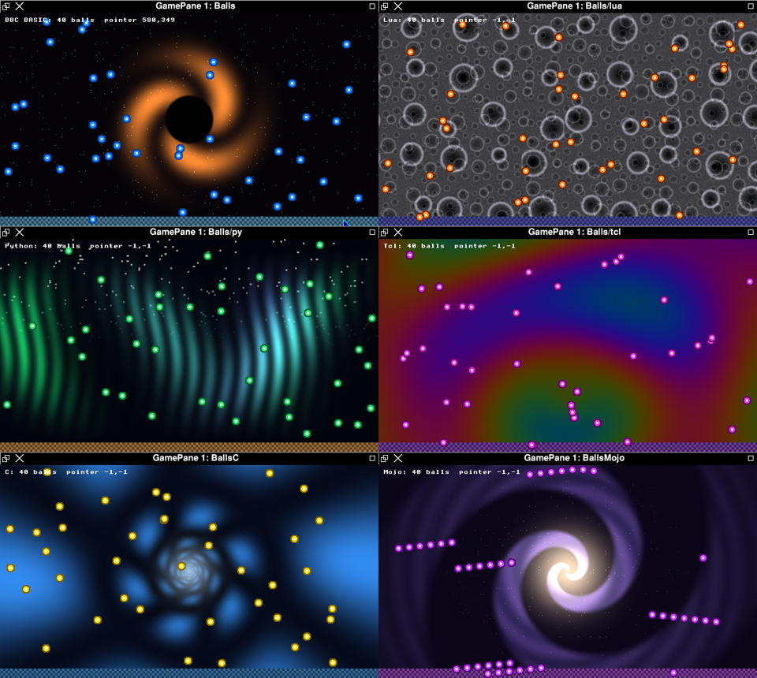

# The Game Pane

*31 October 2026, revised the same day*

**Note: this is work in progress.** When this article was first written
the pane had important gaps: most languages could not use it, a Mac drew
one pane at a time, and the tile layers, sprite flipping and much of ABC
were still to come. Those are now closed, and this revision describes
the pane as it is. One large gap remains: the PCs, and the Intel Macs
that run BOX directly, cannot yet open a pane from a RISC OS program.
Limits, at the end, lists it and the smaller ones.

**Note: this is not RISC OS.** BOX is a RISC OS window manager and
application environment running on a Linux kernel. [Is BOX Linux?](5-Linux.md) says what that means. The game pane is BOX's own,
and is not part of RISC OS.

## Introduction

The game pane is BOX's retro graphics and sound: a window in which a
program draws the way an arcade game of the late 1980s and early 1990s
did, with a palette, scrolling layers, hardware-style sprites and a text
overlay, and plays music and effects on a three-voice synthesiser chip.
None of it is emulated. It is a model of how that hardware worked, drawn
by a modern graphics card, and a synthesiser written from the behaviour
of a famous sound chip.

This article covers:

- the gap the game pane fills;
- the picture, layer by layer, and the hardware each layer stands for;
- the shared block a program writes, and the SWIs;
- !GamePane, which gives any program a pane;
- how the picture is drawn, on a PC and on a Mac;
- the sound chip;
- the ABC player, and the effects;
- Galaxigans, the game written to prove it all;
- the languages that can use it;
- the limits.


---

## 1 The gap

The Acorn machines were fast and clean, but their graphics and sound were
plain. The Archimedes' video controller drew the screen from memory, and
its one hardware sprite was the mouse pointer. Its sound was eight
channels of samples, which software had to make. There was no blitter, no
playfields or tile layers to scroll, no sprites for the game's own
objects, and no synthesiser. Everything a game showed, it drew itself, a
byte at a time, with the processor.

The American machines were built the other way. The Atari 800 had a
display processor that ran a list of instructions for each frame, and
players and missiles drawn by the hardware. The Commodore 64 had eight
hardware sprites, smooth scrolling and the 6581 sound chip: a
three-voice synthesiser with an analogue filter, on one chip. The Amiga had a copper, which changed the
display's registers at a chosen line of the screen; a blitter, which moved
and combined blocks of memory while the processor did something else;
two playfields; hardware sprites; and four channels of sampled sound.
These chips are why the games on those machines looked and sounded as
they did.

The game pane gives BOX programs those things. A RISC OS program can now
put eight thousand sprites over a scrolling scene with a different
palette on every line, and play a tune on a 6581-style chip while its
sound effects play on a second one, without drawing a pixel of it itself.

---

## 2 The picture

The pane is 640 by 360 pixels, always. A pane whose size could be set
would be a framebuffer with extra steps; a fixed size is what the old
hardware had, and what a game is designed around. The window shows it at
whatever size it is, each pane pixel a block of screen pixels, with no
smoothing. At 1280 by 720 each pixel is exactly doubled.

It is built from four layers, drawn in this order, bottom to top:

| Layer | What it is | What it stands for |
| --- | --- | --- |
| 0, the backdrop | a picture worked out for every pixel by a shader, one of twelve scenes | the hand-painted backdrops of the arcade, and the raster effects of the demo scene |
| 1, the canvas | 640 x 360 bytes, each a colour number, with its palettes | the playfield, and the copper |
| 2, sprites | up to 8,192 rectangles cut from a sprite sheet | hardware sprites |
| 3, text | up to 4,096 characters from a 5 x 7 font | the score line |

On a PC there are also up to four tile layers, which scroll; they are
described below.

### The backdrop

Layer 0 is drawn first, and fills the whole pane, so it is also the
frame's clear. It is one triangle and one fragment shader, which works out
the colour of every pixel from its position and the time. There are
twelve scenes: nebula, galaxy, black hole, alien world, moon, nova,
wormhole, gas giant, aurora, pulsar, plasma and binary stars. A program
chooses one by number, or none.

The scenes move with the clock, not with the game, so the sky drifts at
the same speed whether the game is running at thirty frames a second or
sixty. They cost the processor nothing.

### The canvas and the copper

The canvas is 230,400 bytes, one for each pixel, and each byte is a
colour number. There are two palettes:

- colours 16 to 255 come from one global palette of 240 entries;
- colours 0 to 15 come from a palette of their own **for each of the 360
  lines**.

The second is the copper. On the Amiga, the copper changed a colour
register as the beam reached a given line, and the same colour number
then showed a different colour further down the screen. That is how the
Amiga drew its famous rainbow bars across a still picture. The game pane
gives a program a table of 16 colours for every line instead, which
comes to the same thing: write the canvas once, then change the table
every frame, and the picture moves without a pixel being redrawn. The
demonstration's bars are drawn this way, as is the tractor beam in
Galaxigans, which is one colour number painted once and animated by
rewriting that colour on each line.

The canvas can be drawn in two ways. Over the backdrop as a layer, colour
0 is a hole and the backdrop shows through. On its own, it is the whole
picture.

### Sprites

Sprites are rectangles cut from a 512 by 512 sprite sheet. Each sprite is
32 bytes in a table: where it is on the pane, where its picture is on the
sheet, its width and height, its colour scheme and its transparency. The
sheet holds colour numbers, so a sprite's colours come from one of 32
schemes of 16 colours, and the same picture can be a red alien and a
green one. Colour 0 is transparent.

A program draws up to 8,192 sprites a frame, and all of them are drawn in
one instruction to the graphics card. Later sprites are drawn over
earlier ones. A sprite may be flipped left to right or top to bottom, and
drawn two, three or four times its size, as the sprite chips of the time
could double a sprite; it is not rotated. A sprite may be drawn solid, or
blended with what is under it by its transparency.

A program may define a sprite's picture from bytes, or load a sprite file
saved by !Paint: each sprite in it becomes a frame, numbered, and its
colours become a scheme.

Each sprite is held strictly to its own rectangle of the sheet, so that a
neighbouring frame of animation never bleeds into its edge, which is the
fault every sprite-sheet renderer has to guard against.

### Text

The text layer draws up to 4,096 characters, at any pixel position, each
with its own colour and size. A program that draws through the SWIs gets
the RISC OS system font's 8 by 8 characters, lower case and all; the
games in the ROM have their own font of capitals, 5 by 7 pixels. All the
text on the pane is one draw.

### Tile layers

The pane has four tile layers, the parallax scrolling of the 16-bit
consoles. A tile layer is a map of 8 by 8 tiles, up to 128 by 64 cells,
from a sheet of 512 tiles. Each layer has two scroll registers, and its
map repeats both ways for ever at its own size, so layers of different
sizes scrolled at different speeds drift past one another, and a game
scrolls by adding to a number, never redrawing a map. The layers lie over
the canvas and under the sprites, layer 0 at the back; a tile's colour 0
and an empty cell are holes. The graphics card draws all four in one
pass, reading each pixel's cell from the map and its colour from the
tile.

### No blitter

The original game pane, written in Mojo for Windows, had a blitter: a
bank of eight planes and four operations between them (copy, copy with a
transparent colour, AND, OR or XOR, and fill), "the Amiga's blitter" in
its own words. BOX's pane does not need one. A blitter existed to move
pictures around a framebuffer faster than the processor could. In the
game pane the graphics card composes every layer afresh each frame, so a
sprite is moved by changing two numbers in its table.

---

## 3 The block and the SWIs

On BOX a program draws by writing a block of memory, just under 1 MB,
laid out as the hardware's registers and memory would be:

| Part | Size |
| --- | --- |
| a header: the frame number, the backdrop's scene and time, the counts | 64 bytes |
| the canvas | 230,400 bytes |
| the global palette | 1,024 bytes |
| the line palettes | 23,040 bytes |
| the sprite table | 262,144 bytes |
| the text table | 131,072 bytes |
| the sprite sheet | 262,144 bytes |
| the sprite colour schemes | 2,048 bytes |
| the font | 8,192 bytes |
| the tile layers' registers | 128 bytes |
| the four tile maps | 65,536 bytes |
| the tile sheet | 32,768 bytes |

The block is shared with whatever draws the picture. A frame number in
the header keeps the two in step. It is odd while the program is writing
and even when the frame is finished, so the picture is never drawn from
a half-written frame; if the drawer finds it odd, it shows the last
frame again. The sprite sheet, the schemes and the font are large and
rarely change, so they carry a number of their own and are copied to the
graphics card only when it changes. An ordinary frame copies only the
canvas, the palettes and the two tables.

The drawer trusts nothing in the block: it checks the block's mark and
version, and limits every count and every index, so a program with a bug
draws a wrong picture, not a crash.

The tile layers come last, after everything else. A Mac app from before
them still draws the rest of a block that has them, and a newer one knows
a block that has them by its size.

The GamePane module gives the block to a program:

| SWI | Number | What it does |
| --- | --- | --- |
| GamePane_Open | &C0280 | makes a block for a window and binds it to the window; returns its address and size |
| GamePane_Begin | &C0284 | marks the frame as being written |
| GamePane_Present | &C0281 | marks the frame as finished, for the drawer to show |
| GamePane_Drawn | &C0283 | says whether the host is drawing this pane |
| GamePane_Close | &C0282 | unbinds the block and frees it |

A frame is Begin, the writes, then Present. The block is carved from the
memory BOX keeps for windows' pictures, and bound to the window as a kind
of surface; a window may have one, and the box up to four.

Writing the block needs floating-point numbers and a knowledge of its
layout, which BBC BASIC and Tcl do not have. So the module also does the
writing for a program, through SWIs that every language can call:

| SWIs | What they do |
| --- | --- |
| GamePane_Attach | the pane !GamePane made for the program |
| GamePane_Clear, Plot, Rect, Line | draw on the canvas |
| GamePane_Colour, Scene | the palettes, and the backdrop |
| GamePane_DefineSprite, LoadSprites, SpriteColour, Sprite | sprite frames and schemes, and a sprite placed this frame, flipped or scaled |
| GamePane_Text | text placed this frame |
| GamePane_Tiles | tiles, maps, cells and scrolling |
| GamePane_Input | the pointer, the buttons and whether a key is held |
| GamePane_Wait | until the next frame is due |
| GamePane_Tune, Music, Effect | the sound chips |

A SWI costs about a third of a microsecond, so thousands of sprites a
frame are within reach of an interpreted language. A program may mix the
two ways, writing some of the block itself.

`GamePane_Wait` is the vertical blank. It returns a sixtieth of a second
after the last frame, kept to the clock so that a long frame is followed
by a short wait. A program run by !GamePane sleeps while it waits, and
the desktop runs; it takes no time at all.

---

## 4 How it is drawn

The pane is drawn by the graphics card, in one of two ways.

**On a PC**, and on the Intel Macs that run BOX directly, the pane is a
Linux program drawing with OpenGL ES through the machine's own Mesa
driver. It is a Wayland client, and BOX's compositor makes every Wayland
window a Wimp window, with its furniture. The compositor takes the
finished frame from the graphics card's memory as it is, so the picture
never passes through the processor. Frames are timed to the display, at
60 frames a second on most panels. The pane's drawing thread asks for
real-time priority, and so does its sound, at a higher priority, because
a late frame is a glitch and a late sound buffer is a click.

**On a Mac**, the Apple silicon box runs under QEMU, and the program in
the box draws nothing at all. It writes the block, and the Mac's own
graphics, Metal, read the block from the box's memory and draw the
layers into a 640 by 360 picture, which is then shown in the window.
Each pane on the screen has a picture of its own, up to four at once. The
box's processors spend their time on the game alone: Galaxigans runs at
60 frames a second for 7 per cent of one of the box's processors.

The two are written to the same description. Every layer of the PC's
version was proved by a test that draws it without a screen, reads the
pixels back and checks every one against a model worked out by the
processor: all 230,400 pixels of the canvas, twelve scroll positions of
the tile layers, 450 sprites, 133 characters in six colours. On the 2018
Mac mini, with its own Intel graphics, the pane runs at 90 frames a
second; on the 2013 Mac Pro's AMD card, at about 60.

---

## 5 The sound chip

The pane's sound is a model of the 6581, the Commodore 64's sound chip.
It is not an emulation of the 6581's circuits. It is a synthesiser that
does what the 6581's registers say, written from the way the chip
behaves, in integer arithmetic except for its filter.

| Part | What it does |
| --- | --- |
| Voices | three, each an oscillator of 24 bits clocked as a PAL Commodore 64 was, at 985,248 Hz |
| Waveforms | triangle, sawtooth, pulse with a 12-bit width, and noise; several chosen together are ANDed, as the chip did |
| Noise | a 23-bit shift register, with the chip's own feedback taps and the eight bits it took its output from |
| Envelope | attack, decay, sustain and release, from the chip's own table of times, 2 ms to 8 seconds; attack is a straight line, and decay and release slow down as the level falls, as the 6581's did |
| Ring modulation and sync | each voice can take the one before it as the source: ring modulation for bells and gongs, hard sync for the tearing lead sounds |
| Filter | low-pass, band-pass and high-pass, alone or together, with a cutoff and a resonance; any voice can be sent through it |
| Output | 48,000 samples a second, the player stepping 50 times a second, as Commodore 64 music did |

The envelope is the part most synthesisers get wrong. The 6581 did not
fade a note out smoothly: as the level fell, its counter was stepped by a
larger and larger divisor, so the tail of a note stretched. That stretch
is a large part of the chip's sound, and the model has it.

There are **two chips**, one for music and one for sound effects. On the
Commodore 64 a game had three voices for everything, and a shot stole a
voice from the tune; here the effects have their own three voices, so a
shot never cuts the music. The two are mixed and played by a thread of
their own.

On a PC the sound goes to Linux's own sound system, shared with the web
browser. On the Mac it goes through a loopback sound card inside the box,
whose other end BOX's mixer reads, so it comes out of the Mac with the
rest of the box's sound.

---

## 6 Music: the ABC player

Tunes are written in ABC, the plain-text music notation folk musicians
have used since the 1990s:

```
X:1
T:Scale
M:4/4
L:1/8
Q:1/4=120
K:G
[I:chip v=0 wave=pulse pw=500 a=0 d=4 s=6 r=3 vol=12]
GABc defg|gfed cBAG|
```

The player reads the note length (`L:`), the tempo (`Q:`) and the key
(`K:`, any major or minor key, its sharps and flats worked out from the
circle of fifths). It reads notes over the octaves, sharps, flats and
naturals that last to the bar line, rests, and lengths written as
multiples and fractions. Up to eight voices (`V:`) play at once, each
with its own place in the tune, on the chip's three.

It plays repeats, with first and second endings; ties, across a bar line
too; triplets and the other tuplets; and grace notes, which take their
time from the front of the note they lead to. A part has one voice of the
chip, so a chord is played as the Commodore 64's composers played one: an
arpeggio, a note of it every fiftieth of a second, without the envelope
starting again. Chord symbols and decorations are passed over. Every one
of these is checked by a test that reads the notes' times, pitches and
lengths, and another checks that all eighteen of Galaxigans' tunes play
exactly as they did before.

The `[I:chip ...]` field is BOX's own. It sets a voice's sound from
inside the tune: the waveform, the pulse width, the envelope, the filter
and its cutoff, resonance and mode, the volume, ring modulation and sync.
A setting the player does not know is refused by name, not ignored.

The player keeps time in ticks, 480 to a crotchet, and puts every note on
at the exact sample it falls on, not at the next 50th of a second, so a
tune does not drift. Each note is released a little before its end, so
the envelope starts again on the next note, as a player's fingers would.

Sound effects are not tunes. Each is a recipe of chip settings with a
pitch that falls fifty times a second: a shot, an explosion, a dive, a
pick-up and the player's death. They play on the effects chip, a voice
each in turn.

---

## 7 Galaxigans

Galaxigans is the game written to prove all this. It is a Galaxian-style
shoot-'em-up: fourteen species of alien in formation, which peel off and
dive at the player's ship; a bonus saucer with a spinning mine; on every
third wave a capture boss with a tractor beam; a victory dance; and a
hall of fame. It has twelve levels, each with its own backdrop; the
colour themes come round every six.


Its history is a chain of translations, as so much of BOX is. It began
as a game in x86-64 assembler, was ported to Smalltalk in MACVM, then to
Mojo on Windows, and then to C for BOX. None of its art was retyped on
the way. A script reads the sprites from the Mojo source, which had them
from the Smalltalk, which had them from the assembler: 46 sprites, among
them two frames for each of the fourteen species, eight turns of the
mine and four poses of the boss. Another script takes the eighteen tunes
from the Mojo: a motif for each species, played as it dives, and cues for
the title, the end of a stage, the saucer and the aliens' victory. A third
translates the twelve backdrop shaders into the language of each graphics
card, and checks that all 411 numbers in them came across unchanged and
in order.

It runs at a steady 30 steps a second, whatever the frame rate. In BOX it
is `*Galaxigans`, or `*Galaxigans -autoplay` to let the computer play;
Left and Right steer, and Space fires. It is also !Galaxigans on the
disc.

---

## 8 !GamePane

GraphTask showed the shape a feature like this should take: an
application with its own icon, onto which a program is dragged. !GamePane
is in the ROM, under Apps. Drag a program onto its icon and it opens a
pane window and runs the program in it, as the child of a task window,
so the program need not be a Wimp task at all. A BBC BASIC program, a
Lua, Python or Tcl script, or an application made by `*CC` or `*Mojo`
all run the same way. The program asks for its pane with
`GamePane_Attach` and draws.

Click on the pane and keys go to the program, which reads them as a
1980s game read its joystick: by asking whether a key is held now.
`*GamePane <command>` runs a command in a new pane from the command line
or a script. When the program ends, the window stays with its last
picture and the word "finished" in its title; anything the program
printed, and the error that stopped it if there was one, is drawn over
the bottom of the picture. Menu on a pane gives its scale (one, two or
three times), sound off, and Kill.

---

## 9 Which languages can use it

Each language has a small library over the SWIs, a Balls example in
`!GamePane.Examples`, and a page in the GamePane manual in !Manuals:

| Language | The library |
| --- | --- |
| BBC BASIC | `LIBRARY "<GamePane$Dir>.Lib.GamePane"`: `PROCgp_rect`, `PROCgp_sprite`, `FNgp_key`, `FNgp_tune` and the rest |
| Lua | `require "gamepane"` |
| Python | `import gamepane` |
| Tcl | `package require gamepane` |
| Mojo | `from riscos.gamepane import attach` |
| C, with `*CC` | `#include "gamepane.h"`, a header of inline functions |
| C, in the ROM | the block itself: the demonstration and Galaxigans |
| Lisp | `(require 'gamepane)` and `(require 'sound)` in !Lisp, a pane in a Declaritive window |
| Smalltalk | the GamePane class in !Smalltalk |

All six of the first languages were run in !GamePane in the Apple silicon
box: each drew forty sprites over a backdrop and a scrolling strip of
tiles, read the pointer, played its tune and stopped on Q.



In BBC BASIC a pane is a few lines:

```basic
LIBRARY "<GamePane$Dir>.Lib.GamePane"
PROCgp_attach
PROCgp_scene(2,TRUE)
PROCgp_colour(3,255,200,0)
x%=0
REPEAT
  PROCgp_begin
  PROCgp_clear(0)
  PROCgp_rect(x%,170,20,20,3)
  PROCgp_end
  PROCgp_wait
  x%=(x%+2) MOD 620
UNTIL FNgp_key(-17)
```

In Lisp, a pane and a tune are a few lines too:

```lisp
(gp-open window "pane")
(gp-colour 16 255 200 0)
(gp-rect 100 100 50 50 16)
(gp-present)
(snd-start)
(snd-music (snd-tune "X:1
T:Scale
M:4/4
L:1/8
K:C
CDEF GABc|") nil)
(snd-effect :shot)
```

The Lisp examples include Conway's Game of Life on a game pane, a ball
bouncing over the black-hole backdrop, and a jukebox of chip tunes.

---

## 10 Limits

- `GamePane_Open` needs a host to draw the block. The Mac has one; the
  PCs, and the Intel Macs that run BOX directly, do not yet, so there a
  RISC OS program cannot open a pane, and the demonstration and
  Galaxigans run their Linux versions instead. The next step is for the
  PCs' presenter to draw the block itself, as the Mac does.
- Lisp and Smalltalk draw through their own engines, in panes of their
  own windows; their programs are not run by !GamePane.
- The ABC player has no broken rhythm (`>` and `<`), no repeats inside
  repeats, and no key or length changes in the middle of a line.
- Sprites are not rotated.
