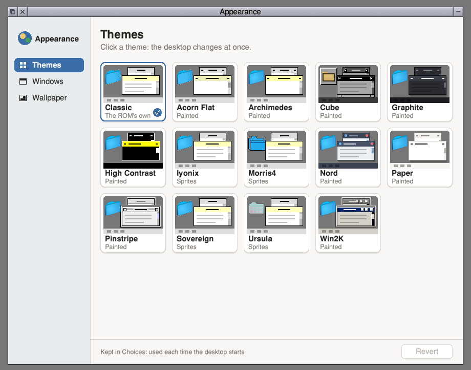
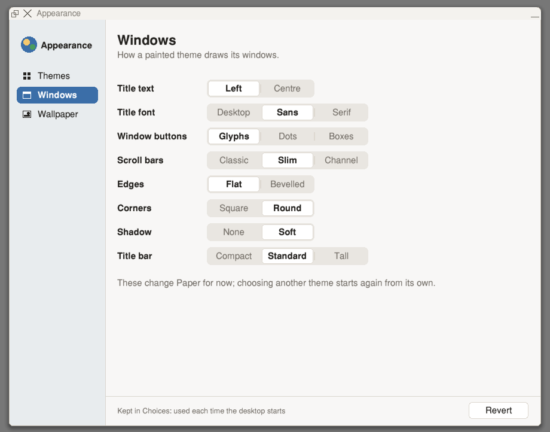
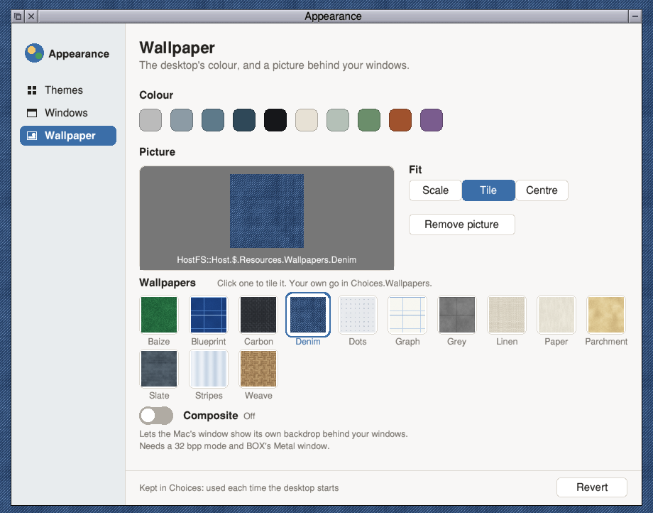

# Appearance

Appearance sets the look of the BOX desktop in one window.
It has three pages, listed down the left side.

**Themes.** Each theme is a card showing a small desktop in that theme's colours.
A click on a card changes the desktop at once.

**Windows.** The painted themes have settings for the title text, the title font, the window buttons, the scroll bars, the edges, the corners, the shadow and the height of the title bar.
These are greyed out under a theme drawn from sprites.

**Wallpaper.** Choose the desktop's colour, a wallpaper tile or a picture dragged to the window.
The Composite switch lets the Mac window's own backdrop show through behind the desktop.

Each choice is saved as it is made in `<Choices$Write>.Appearance`.
That file is run again when the desktop starts.
The Revert button puts back what was chosen when Appearance started.

Appearance is a RISC OS desktop application written in C against the BOX's C library.

## What is here

`appearance.c` is the one C file of the application.

## Licence

Each source file names its licence in its header.
The BOX project asserts no ownership of translated code.
